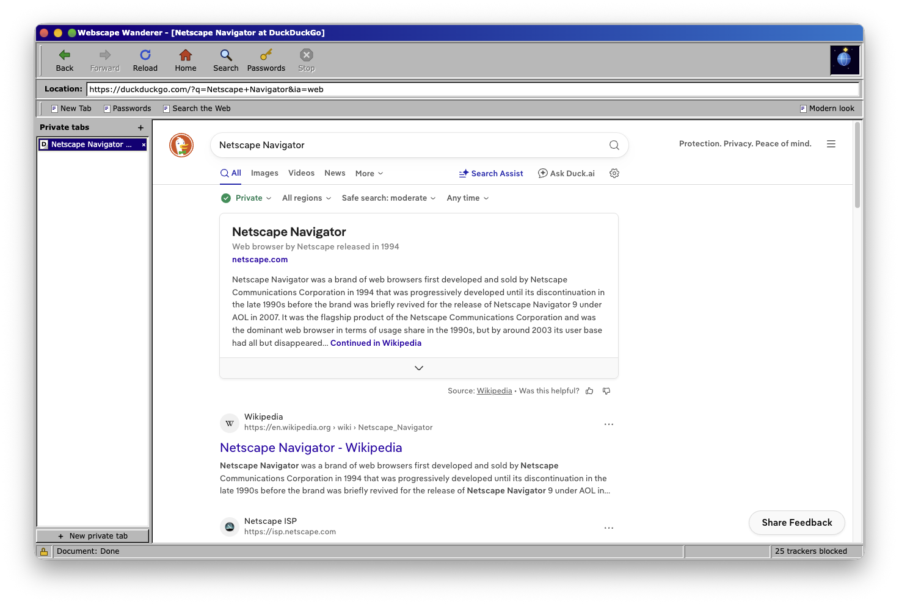

<p align="center">
  
</p>

<h1 align="center">Webscape Wanderer</h1>

<p align="center"><a href="https://github.com/ancientcomputing/webscape/actions/workflows/ci.yml"></a></p>

A private-by-default web browser built on Chromium. Every tab has its own memory, nothing about your browsing is written to disk, tabs are vertical, and passwords are built in. There are no extensions.

> Status: early prototype (v0.1). It works as a daily browser for basic use, but it hasn't had a security audit. See [Limitations](#limitations).

## What makes it different

| | |
|---|---|
| **Each tab has its own memory** | Every tab gets its own in-memory Chromium partition: its own cookies, localStorage, IndexedDB, cache and service workers. Tab A can't see that you're signed in on tab B, and trackers can't link the two. When you close a tab, its memory is wiped. |
| **Nothing is written to disk** | Tab partitions never get a `persist:` prefix, so Chromium keeps them in RAM only. When you quit, everything is gone. There's no history, no cookie jar and no session restore. |
| **Vertical tabs** | Tabs are listed in a sidebar. Popups such as "Sign in with…" open as linked tabs, indented under the tab that opened them. |
| **Built-in password vault** | Saves and fills logins natively, with no extension involved. The vault is encrypted with the OS keychain and unlocked with Touch ID on Macs that have it. It fills only when you click, never automatically, and only on the site the login was saved for. It includes a password generator. |
| **Tracker blocking in the network layer** | Requests to ads and trackers are cancelled before they leave the browser, using Ghostery's filter engine and its prebuilt ads-and-tracking lists. |
| **No extensions** | Extensions are a major source of browser data leaks. Everything an extension would do here is built in. |

### Floating address box

The sidebar shows a compact address. Hover over it and the **whole address** appears in a wide box floating over the page, with the site's domain in bold so look-alike domains stand out. Click it, or press **⌘L**, and the same box becomes a full-width field for typing. Return goes there; Esc cancels. If you switch to another app, the box stays open with what you typed.

### Light and dark

The modern look follows your system's light or dark setting. To force one, use **View → Appearance** or the sun/moon button at the top of the sidebar. Web pages that support dark mode follow along.

### Legacy mode

Press **⇧⌘L**, or use **View → Legacy Mode**, for a mid-90s desktop-browser look:



- gray `#C0C0C0` chrome with 3D bevels and 12px Verdana, legible on high-DPI screens
- a big labelled toolbar (Back, Forward, Reload, Home, Search, Passwords, Stop)
- a globe throbber that spins while pages load
- a `Location:` bar and a personal toolbar
- tabs in a classic list box with navy selection
- a status bar with a padlock, progress bar and tracker count
- a 1996-style start page, where you are always visitor number 000001

Switch back with **Modern look** on the personal toolbar. The look you choose is remembered. It's the only UI preference the browser saves.

Legacy mode is an original homage to that era and uses no third-party logos or artwork.

### Other hardening

- Sends `Sec-GPC: 1` (Global Privacy Control) and `DNT: 1` on every request.
- Turns off the WebRTC local-IP leak (`disable_non_proxied_udp`).
- Removes the `Electron/x` token from the user agent, so sites see standard Chrome.
- Turns off the spell checker, which would download dictionaries from Google.
- Asks before granting camera, microphone, location or screen sharing. A grant lasts only as long as the tab. Notifications and other permissions are denied.
- Shows letter avatars instead of favicons, so the browser UI never makes requests outside a tab's memory.
- Clears copied passwords from the clipboard after 30 seconds.
- Runs every page sandboxed with context isolation. The password helper runs in an isolated world that the page's own scripts can't reach.

## How tabs and memory work

```
┌────────────── Window ──────────────┐
│ Sidebar UI (local files only)      │
│                                    │
│  Tab 1 ── partition "tab-<uuid1>"  │  ← own cookies, storage, cache (RAM)
│  Tab 2 ── partition "tab-<uuid2>"  │  ← fully separate
│   └ popup ── shares "tab-<uuid2>"  │  ← sign-in popup keeps window.opener
└────────────────────────────────────┘
```

- **New tab, link opened in a new tab, middle-click:** gets a new, separate memory.
- **Scripted popup** (`window.open` with window features, used by OAuth and payment flows): shares the memory of the tab that opened it, so the sign-in flow can finish.
- **Close the last tab using a partition:** its storage, cache and HTTP auth are cleared right away.

## Passwords

1. Sign in on a site. When the form is submitted, the sidebar asks **Save password?**
2. Choose **Save** and confirm with Touch ID. The login is encrypted into `vault.bin` in the app's data folder.
3. The next time that site shows a password field, the sidebar offers **Fill password**.

The vault only saves and fills on `https://` origins, plus `http://localhost` for developers. It locks itself after 10 minutes without use. Open it with **⇧⌘P** to search, copy, delete, add logins or generate passwords.

## Keyboard shortcuts

| Shortcut | Action |
|---|---|
| ⌘T / ⌘W | New private tab / close tab |
| ⌘L | Open the address box for typing |
| ⌘R / ⇧⌘R | Reload / reload ignoring cache |
| ⌘[ / ⌘] | Back / forward |
| ⌃Tab / ⌃⇧Tab | Next / previous tab |
| ⌘1…⌘9 | Jump to a tab (⌘9 = last) |
| ⇧⌘P | Open the password vault |
| ⇧⌘L | Toggle Legacy mode |
| ⌥⌘I | Developer tools for the current tab |

On Windows and Linux, use Ctrl instead of ⌘.

## Build and run

You need Node.js 20 or newer.

```bash
git clone https://github.com/ancientcomputing/webscape.git
cd webscape
npm install
npm start          # builds the TypeScript and launches the browser
npm run icon       # re-renders build/icon.png from build/icon.svg
npm run dist       # packages a .dmg / AppImage / installer into release/ with electron-builder
```

### Project layout

```
src/
  main/
    main.ts        app lifecycle, window, menu, IPC
    tabs.ts        TabManager: one WebContentsView + one in-memory partition per tab
    privacy.ts     per-session hardening: blocker, headers, permissions, preload
    vault.ts       encrypted password vault (safeStorage + Touch ID)
  preload/
    ui-preload.ts  narrow, allow-listed bridge for the sidebar
    page-preload.ts  login-form detection and fill, in an isolated world
  ui/              sidebar (HTML/CSS/TS), legacy.css (90s look), start page, error page
  shared/types.ts  types shared by main and UI
build/             app icon (SVG source, PNG, ICNS)
scripts/           build helpers; dev-app-name.mjs names the dev Electron.app "Webscape Wanderer"
```

## What is stored on disk

| File | Contents |
|---|---|
| `vault.bin` | Your saved logins, encrypted with the OS keychain |
| `blocker-engine.bin` | Compiled tracker filter lists (no personal data) |
| `settings.json` | UI look (modern or legacy, light or dark) |
| Chromium housekeeping | GPU shader caches and the sidebar UI's own storage. Web pages never use this profile. |

The folder is `~/Library/Application Support/Webscape Wanderer` on macOS, `%APPDATA%` on Windows and `~/.config` on Linux.

## Limitations

- **Engine updates:** the browser uses Electron's bundled Chromium, which usually trails Chrome's security fixes by a few days to a few weeks. Dependabot checks for a new Electron every day and opens a pull request, and CI builds and smoke-tests it (see [Keeping the engine current](#keeping-the-engine-current)). Merge those pull requests promptly.
- **No extensions:** this is a design choice, and it won't change.
- **No sync:** passwords stay on this machine.
- **No Touch ID fallback:** on Macs without Touch ID, and on Windows and Linux, the vault is protected only by your OS login keychain. There is no extra prompt.
- **Fingerprinting:** tab isolation stops cookie and storage tracking. It doesn't stop browser fingerprinting.
- **Two-step logins:** sign-ins where the username and password are on separate pages may save without the username.
- **Unsigned builds:** builds aren't code-signed yet, so macOS asks you to approve them on first launch.

## Keeping the engine current

The browser engine is the `electron` package, which bundles Chromium. Electron releases a new major version about every 8 weeks and supports only the newest three, so an app that isn't updated stops getting security fixes within about six months.

- **Dependabot** ([.github/dependabot.yml](.github/dependabot.yml)) checks npm daily. Electron updates get their own pull request.
- **CI** ([.github/workflows/ci.yml](.github/workflows/ci.yml)) type-checks, builds, **smoke-tests** and **vault-tests** every pull request on macOS. The smoke test launches the real browser and checks that the UI loads, that each tab gets its own in-memory session, and that the user agent doesn't reveal Electron.
- **Patch and minor updates** are mostly security fixes. Merge them as soon as CI is green.
- **Major updates** can change Electron's APIs. Merge them after CI passes and a quick manual check with `npm start`.

Run the checks locally with:

```bash
npm run build && WEBSCAPE_SMOKE_TEST=1 npx electron .   # smoke test
npm run test:vault                                     # password vault, via the real keychain
```

The vault test uses its own keychain entry and a temporary folder, so it never touches your saved passwords.

## Contributing

Issues and pull requests are welcome. Please keep the core promise intact: **no browsing data on disk, no extensions, and no network requests that aren't made by the page you're viewing.** Report security problems privately (see [SECURITY.md](SECURITY.md)), not in public issues.

## License

[Apache License 2.0](LICENSE). Webscape Wanderer is an independent project and isn't affiliated with Netscape, AOL or Google.
